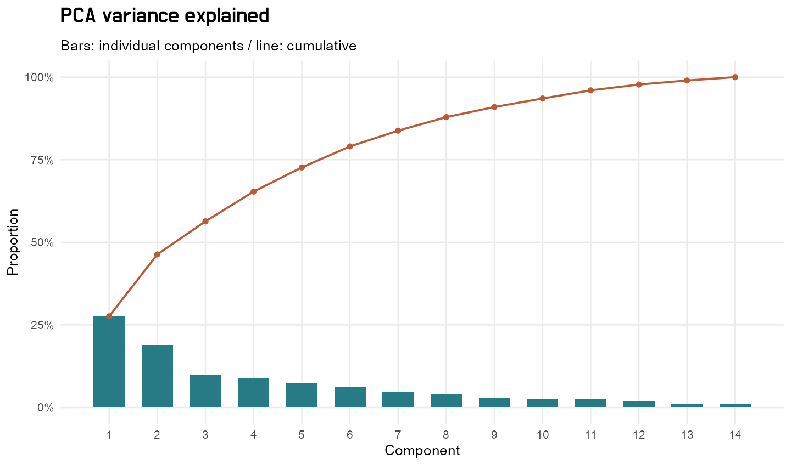
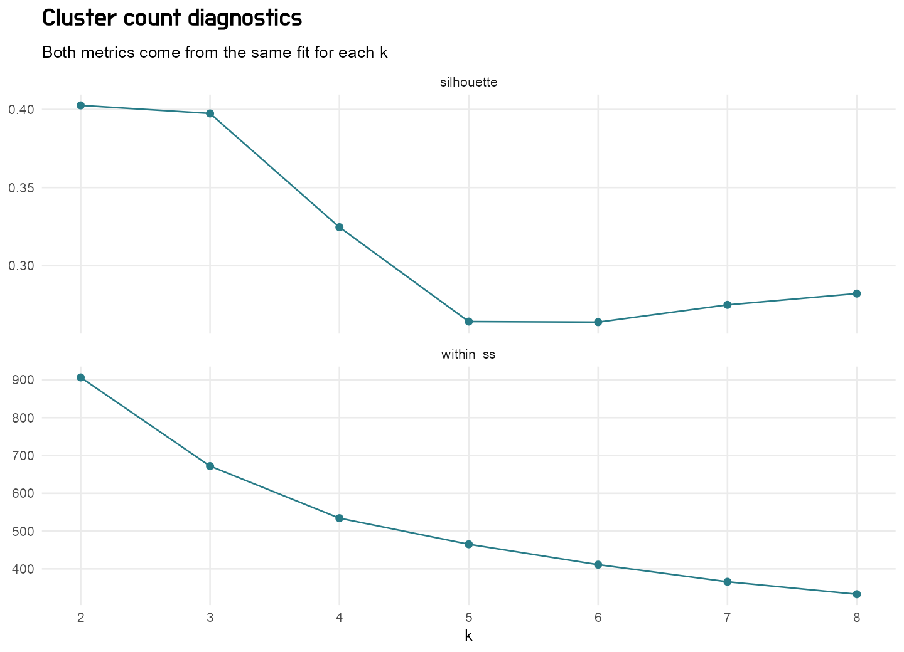
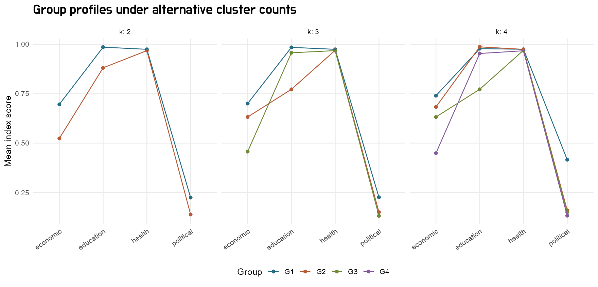

# Course-data result snapshots

These aggregate tables and three figures were generated by the local, verified 2017 course-data run. They are **not synthetic-demo results**. They cover 144 countries, 14 detailed indicators and the configuration in `config.json`.

No raw course CSV, country-level joined data, individual cluster membership, original coursework report or reference document is included here. The input digests are in `data/manifest.json`; the dataset description is in `data/README.md`.

The four-PC explained variance is 65.37%; the four group sizes are 27, 81, 14 and 22. `cluster_choice.csv` shows that k=2 has the highest mean silhouette among the tested counts. `complete_case_comparison.csv` documents sensitivity to using the 90 completely observed countries.

`historical_comparison.csv` compares principal components and the main partition with saved and recomputed historical results. `original_reproduction_tables.csv` checks all 12 historical tables. No claims are made that a synthetic run reproduces these empirical numbers.

